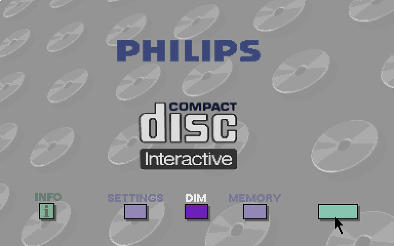

# Philips CD-i 205 — Émulateur

> ⚠️ **Avertissement légal** — Ce projet ne fournit aucune ROM, BIOS ni logiciel sous copyright. Philips conserve tous les droits sur ses œuvres. Les fichiers `.bin`, `.rom` et `.iso` **ne doivent jamais** être committés (voir `.gitignore`). Ce dépôt ne contient que des outils d'analyse et de documentation de reverse-engineering à des fins éducatives.

---

## 🎯 Objectif

Émulateur fonctionnel du **Philips CD-i 205**, ordinateur de salon basé sur un Motorola 68070, exécutant l'OS **CD-RTOS** (dérivé d'OS-9 68k), avec support de la **Digital Video Cartridge** (cartouche FMV) pour la lecture de vidéo MPEG-1.

**Plateforme cible** : Windows / Linux / macOS (C99 + SDL2 / SDL2_ttf)

---

## 📍 Où en est l'émulateur

Avec la ROM `CDI205-00_PS-7211_REL.2.1`, l'émulateur démarre CD-RTOS jusqu'au
**menu principal du CD-i, en couleurs** (fond, logo PHILIPS, boutons INFO /
SETTINGS / DIM / MEMORY / OPEN, curseur matériel) :



Ce qui fonctionne :

- **CPU 68070** : interpréteur 68000 + trame d'exception courte du 68070
  (SR, PC, format/vecteur), USP/SSP, `TRAP`, `RTE`, `STOP`, interruptions
  par niveau, ADDX/SUBX, DIVU/DIVS, CHK, TRAPV, EXT, MOVE SR/CCR, accès
  lecture-modification-écriture corrects.
- **Périphériques internes du 68070** : timer T0/T1/T2 (tick OS-9 à 100 Hz),
  registres de priorité PICR1/PICR2, UART (console SDL).
- **68HC05 (HLE)** : réponses aux requêtes de CD-RTOS, IRQ niveau 2,
  pointeur absolu (souris / clavier).
- **NVRAM + horloge M48T08** : sauvegarde automatique, slots F5/F9.
- **CDIC (lecteur CD)** : commandes du pilote `cdapdriv` (reset, TOC,
  lecture mode 1 / mode 2 avec filtres fichier / canal, seek, update),
  secteurs livrés à 75 par seconde dans les tampons de la RAM du CDIC
  avec leur sous-code Q, interruption niveau 4. Images `.cue`/`.bin`
  (2352 octets) et `.iso` (2048 octets). Le 68HC05 signale le disque à
  CD-RTOS (`B0 00 02 15`). Les secteurs passent en mémoire par le **DMA
  du 68070** (canal 1, `$80004000`), comme sur la vraie machine.
- **Lancement d'un disque** : PLAY CD-I → `launcher` lit le label, le
  répertoire et l'application, qui démarre. Testé avec *Astérix : Le Défi
  de César* : intro Philips, logos Philips Interactive Media / Pathé /
  Infogrames, dessin animé d'introduction (avec musique) et **écran titre**
  du jeu (JOUER / REJOUER / RÈGLE / FIN) ; JOUER lance la partie.
- **Vitesse réelle** : le temps émulé (cycles à 15 MHz) suit l'horloge du
  PC ; trames vidéo à 50 Hz (lignes de 64 µs).
- **Audio ADPCM CD-i** : les secteurs audio du canal choisi vont dans les
  tampons audio du CDIC (`$2800`/`$3200`), sont décodés (niveaux A/B/C,
  mono/stéréo, 37,8/18,9 kHz) et joués par SDL. La musique de l'intro
  d'Astérix sort correctement.
- **Interruption vidéo** : l'instruction INTERRUPT des programmes ICA lève
  IT1 (niveau 5, autovecteur 61) à chaque trame — c'est le « top » dont
  les jeux se servent pour se synchroniser.
- **Reset par le 68HC05** (`$8A` sur `$200005`) : redémarrage à chaud après
  un `F$Panic` / « Fatal System Error », comme le vrai lecteur.
- **Vidéo** : les deux SCC66470 d'après leur datasheet (maître = plan A en
  DRAM banque 1, esclave = plan B en banque 2) — programmes ICA/DCA,
  fichiers bitmap / run-length / mosaïque en 4 et 8 bits/pixel, bordure,
  résolutions — puis le V.S.D. (palette CLUT 256 couleurs en 4 banques,
  codage CLUT7/CLUT8, clé de transparence par plan, ordre des plans,
  superposition, curseur) et décodage **DYUV** des images naturelles
  (deltas quantifiés du Green Book, valeur de départ CA/CB, YUV → RGB),
  facteurs de contribution DB/DC et mixage des plans (fondus).
- **Sons en mémoire** (« ap ») : tampons `$2800`/`$3200` remplis par DMA,
  lecture via AUDCTL/ABUF avec interruption (voix et bruitages des jeux).
- **Pointeur relatif** : le 68HC05 applique les repositionnements du pilote
  (`C0..` sur `$200001`) ; la souris donne des déplacements, les flèches des
  impulsions (jeux qui lisent le pointeur comme une manette).

Pas encore émulé : audio CD-DA, drapeaux de région (matte) et facteurs
par région, bit T du RGB555 dans la transparence des plans, RGB555, valeurs de départ DYUV rechargées ligne
par ligne, interruptions
UART/I²C, éjection / changement de disque en cours de route, afficheur de
façade, cartouche FMV.

### Charger un disque

```bash
./cdi205 "chemin/vers/jeu.cue"
```

ou `EMU_DISC=chemin/vers/jeu.cue`. Sans image, le lecteur est vide et le
menu propose OPEN. Formats : `.cue` + `.bin` (un seul fichier BIN, pistes
MODE1/MODE2/AUDIO en 2352 octets), `.bin`/`.img` brut (une piste CD-i),
`.iso` (secteurs de 2048 octets).

### Contrôles

| Action | Touche / souris (fenêtre vidéo) |
|---|---|
| Déplacer le curseur CD-i | souris, ou flèches (Maj = plus vite) |
| Bouton 1 (valider) / bouton 2 | clic gauche / droit, ou Espace-Entrée / Retour arrière |
| Sauvegarder NVRAM + horloge dans le slot courant | **F5** |
| Rappeler le slot courant | **F9** |
| Slot suivant (1 → 9) | **F6** |

### Sauvegardes de jeu et horloge

- La NVRAM (où les jeux CD-i enregistrent leurs parties) est écrite dans
  `nvram.bin` **automatiquement 2 s après chaque modification**, et à la
  fermeture ; l'écriture est atomique (fichier temporaire puis renommage).
- L'horloge M48T08 (`$3FBFF0`) suit l'heure du PC ; si on la règle depuis le
  CD-i, seul le décalage est mémorisé dans `nvram.rtc`, et elle continue
  donc de tourner entre deux sessions.
- `EMU_NVRAM=chemin/nom` utilise `nom.bin` / `nom.rtc` à la place (une
  NVRAM par joueur ou par jeu, par exemple).
- F5 / F9 : instantanés complets NVRAM + horloge dans `saves/slotN.sav`.

### Options de debug (variables d'environnement)

| Variable | Effet |
|---|---|
| `EMU_VIDEO_LOG=1` | journalise l'état vidéo (DCR, ICA, commandes BEP) |
| `EMU_VIDEO_DUMP=frame.bmp` | enregistre l'image affichée à chaque changement |
| `EMU_TRACE=1`, `EMU_TRACE_MAX=n` | trace instruction par instruction |
| `EMU_PC_POLL=n` | affiche le PC toutes les `n` instructions |
| `EMU_SLAVE_LOG=1` | journalise le dialogue avec le 68HC05 |
| `EMU_CDIC_LOG=1` | journalise les commandes et les secteurs du CDIC (`2` : chaque interruption) |
| `EMU_DISC=jeu.cue` | image disque à charger (sinon 1er argument) |
| `EMU_OS9_LOG=1` | trace les appels système OS-9 en erreur (`2` : tous) |
| `EMU_EXC_LOG=1` | signale les exceptions CPU (erreur d'adresse, instruction illégale…) |
| `EMU_UART_LOG=1` | recopie la console UART sur stderr |
| `EMU_BREAK=1A96D0,1A9706` | à ces PC : 64 derniers PC, registres, pile, code |
| `EMU_SPEED=100` | vitesse en % du vrai CD-i (`0` = sans limite) |
| `EMU_AUDIO=0` / `EMU_AUDIO_DUMP=son.wav` | coupe le son / enregistre le son en WAV |
| `EMU_WATCH=E5100-E5200`, `EMU_WATCH_AFTER=n` | signale les écritures dans cette plage (et si c'est le DMA) |
| `EMU_DMA_LOG=1` | journalise chaque transfert DMA CDIC ↔ mémoire |
| `EMU_INPUT_REC=f.rec` / `EMU_INPUT_PLAY=f.rec` | enregistre / rejoue souris et clics au pas près (tests reproductibles) |
| `EMU_AUTOCLICK=x,y,pas` | clic automatique du bouton 1 (répété 8 fois) |
| `EMU_NVRAM=nom` | fichiers NVRAM/horloge `nom.bin` / `nom.rtc` |

---

## 📂 Arborescence du code de l'émulateur

```
src/cdi_emu/
├── main.c                    ← boucle principale (CPU, timer, IRQ, vidéo, SDL)
├── build-project.bat         ← compilation Windows (gcc)
├── ROM/                      ← ROM système (non fournie, voir avertissement)
└── core/
    ├── bus.c/h               ← carte mémoire et routage MMIO
    ├── rom_loader.c/h        ← chargeur Intel HEX
    ├── rtc_m48t08.c/h        ← horloge M48T08 (RTC) de la NVRAM
    ├── CPU/
    │   ├── m68k*.c/h         ← CPU 68070 (décodage, modes d'adressage, exceptions)
    │   ├── onchip68070.c/h   ← timer + PICR du 68070
    │   ├── uart.c/h          ← UART du 68070
    │   └── uart_console.c/h  ← terminal UART (SDL2 + SDL2_ttf)
    ├── GPU/
    │   ├── scc66470.c/h      ← contrôleur vidéo SCC66470 ×2 (registres, ICA/DCA, rendu)
    │   ├── vsd.c/h           ← V.S.D. : palette, codage, transparence, plans, curseur
    │   └── video_display.c/h ← fenêtre vidéo SDL2
    ├── SLAVE/                ← co-processeur 68HC05 (HLE : requêtes, pointeur)
    └── CDIC/                 ← contrôleur CD (cdic.c) + images disque (disc.c)
```

---

## 🔬 Deux axes de recherche

Ce projet sépare rigoureusement l'analyse en **deux axes indépendants** :

### Axe A — CONSOLE (CD-i 205)
> Le matériel de base, commun à tous les modèles CD-i.

- **CPU** : Motorola 68070 @ 15 MHz (68000 + périphériques intégrés)
- **Vidéo** : 2 × SCC66470 (VSC maître + esclave, un plan chacun) → V.S.D. (palette / mixage) → DAC ADV7120
- **Audio** : ADPCM PCM/FSCM, DAC stéréo
- **Système** : CD-RTOS (OS-9/68000), NVRAM, lecteur CD + contrôleur CDIC
- **Fichiers** : `docs/console/`

### Axe B — CARTOUCHE FMV (Digital Video Cartridge)
> L'accessoire enfichable optionnel, décodant le MPEG-1.

- **Modules OS-9** : `fmvdrv`, `fmvll`, `csd_fmvvm`…
- **Décodeur** : chip MPEG-1 (SGS-Thomson ?), MMIO dédié `$E80000–$EFFFFF`
- **Handshake** : IRQ dédiée, registre de contrôle `$C0`
- **Fichiers** : `docs/fmv/`

> ⚠️ **Règle de délimitation** : les adresses `$E80000–$EFFFFF` sont **réservées à la FMV**. La console ne doit jamais y accéder.

---

## 📊 Tableau d'avancement

### Axe Console — implémentation en cours
| Tâche | État |
|-------|------|
| Extraction ROM CD-RTOS | ✅ Terminé |
| Cartographie mémoire complète | ✅ Terminé |
| Boot CD-RTOS jusqu'au menu principal | ✅ Terminé |
| Exceptions / interruptions 68070 | ✅ Terminé |
| Implémentation timers 68070 | ✅ Terminé |
| Implémentation UART (sans interruptions) | ✅ Terminé |
| SCC66470 : ICA/DCA, bitmap, run-length, mosaïque | ✅ Terminé (plan A) |
| SCC66470 esclave (plan B) | ✅ Terminé |
| V.S.D. : palette, transparence, ordre des plans, curseur | ✅ Terminé (superposition) |
| V.S.D. : DYUV | ✅ Terminé |
| V.S.D. : mixage pondéré, RGB555 | 🔲 À démarrer |
| CDIC : commandes, TOC, lecture de secteurs | ✅ Terminé (à valider sur de vrais disques) |
| CDIC : audio ADPCM (lecture disque) | ✅ Terminé |
| CDIC : audio CD-DA, sons en mémoire (« ap ») | 🔲 À démarrer |
| Émulation NVRAM + horloge (sauvegardes) | ✅ Terminé |
| Entrées : pointeur via 68HC05 (HLE) | ✅ Terminé |
| Afficheur de façade | 🔲 À démarrer |
| Émulation DMA audio | 🔲 À démarrer |

### Axe FMV — implémentation en cours
| Tâche | État |
|-------|------|
| Dump & analyse désentrelacé | ✅ Terminé |
| Extraction des 15 modules OS-9 | ✅ Terminé |
| Analyse fmvll : table d'init @ $1EE0 | ✅ Terminé |
| Analyse fmvdrv : dispatcher + codes | ✅ Terminé |
| Cartographie MMIO $E80000–$EFFFFF | ✅ Terminé |
| Routine IRQ @ $022E | ✅ Terminé |
| Chaîne d'appel complète | ✅ Terminé |
| Décodage des 24 codes SetStat | ✅ Terminé |
| Identification chip MPEG | ✅ Terminé |
| Reverse-engineering csd_fmvvm | ⚠️ En cours |
| Émulation buffer vidéo MPEG | ⚠️ En cours |
| Synchronisation audio/vidéo | 🔲 À démarrer |

---

## 🚀 Pour commencer

1. **Cloner le dépôt**
   ```bash
   git clone https://github.com/Geremy44/Philips-CD-I-205-Emulateur.git
   cd Philips-CD-I-205-Emulateur
   ```

2. **Compiler l'émulateur** (gcc + SDL2 + SDL2_ttf, par ex. MSYS2 UCRT64)
   ```cmd
   cd src\cdi_emu && build-project.bat
   ```
   ou directement :
   ```bash
   cd src/cdi_emu
   gcc -O2 -std=c11 -DSDL_MAIN_HANDLED $(pkg-config --cflags sdl2 SDL2_ttf) \
       main.c core/*.c core/CPU/*.c core/GPU/*.c core/SLAVE/*.c core/CDIC/*.c \
       $(pkg-config --libs sdl2 SDL2_ttf) -o cdi205
   ```

3. **Explorer la documentation**
   - Console : `docs/console/CONSOLE_OVERVIEW.md`
   - FMV : `docs/fmv/FMV_OS9_FINDINGS.md`

4. **Utiliser les outils d'analyse**
   ```bash
   cd tools && python os9_module_parser.py --help
   ```

5. **Exécuter l'émulateur** (depuis `src/cdi_emu`, la ROM est lue dans `ROM/`)
   ```bash
   cd src/cdi_emu && ./cdi205
   ```
   Deux fenêtres s'ouvrent : le terminal UART et la sortie vidéo. Le menu
   apparaît après une trentaine de secondes.

6. **Dépendances**
   L'émulateur nécessite les bibliothèques SDL2 et SDL2_ttf :
   - Ubuntu/Debian : `sudo apt-get install libsdl2-dev libsdl2-ttf-dev`
   - macOS : `brew install sdl2 sdl2_ttf`
   - Windows : Télécharger les bibliothèques depuis https://www.libsdl.org/

---

## 📄 Licence

Documentation de reverse-engineering à fins éducatives uniquement. Voir avertissement légal en tête de fichier.

---

*Dernier mise à jour : 20 novembre 2026*
